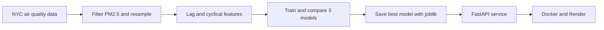

# PM2.5 Forecast API

**Time-series forecasting of fine particulate matter (PM2.5) for New York City, served through an authenticated, tested and containerized REST API.**

This project started as a data science capstone during an Erasmus+ exchange at IMC Krems University of Applied Sciences. It covers the full path from raw open data to a deployed prediction service: exploratory analysis, feature engineering, model comparison, an API, tests, Docker and deployment configuration.

---

## Problem

Air pollution affects urban populations unevenly, and fine particles (PM2.5) are linked to respiratory and cardiovascular disease. Forecasting PM2.5 from recent measurements helps anticipate periods of poor air quality. This project asks a practical question: how well can simple models predict the next PM2.5 level from the previous three measurements and the time of year?

## Pipeline



1. **Data preparation:** the PM2.5 series is filtered, resampled to uniform 6-month intervals and cleaned.
2. **Feature engineering:** three lag features (`pm25_lag_1` to `pm25_lag_3`), year and month, plus cyclical encodings of the month (`sin_month`, `cos_month`) so that December and January are treated as neighbors.
3. **Model comparison:** Linear Regression, XGBoost and Random Forest, evaluated on a chronological split (the first 23 records for training, the last 4 for testing) instead of a random one, to avoid leaking future information.
4. **Serving:** the selected model is saved with joblib and exposed through a versioned FastAPI endpoint. A second, location-aware model adds a location code as an input.

## Results

| Model | MAE (µg/m³) | RMSE (µg/m³) |
| --- | --- | --- |
| **Linear Regression (selected)** | **0.76** | **1.09** |
| Random Forest | 1.05 | 1.09 |
| XGBoost | 1.08 | 1.41 |

The simple linear baseline performed best. The dataset is small and strongly seasonal, so the tree-based models had little to gain and tended to predict toward the mean. Note that the hold-out set contains only 4 records, so these numbers are indicative, not conclusive. Detailed write-ups for each experiment are in [`docs/`](docs/).

## API

Interactive documentation is available at `/docs` when the service is running. All prediction endpoints require an `x-api-key` header.

| Endpoint | Model | Inputs |
| --- | --- | --- |
| `POST /v1/predict/predict` | Linear Regression | `pm25_lag_1`, `pm25_lag_2`, `pm25_lag_3`, `year`, `month` |
| `POST /v1/predict/predict/geo` | Location-aware Linear Regression | `pm25_lag_1`, `pm25_lag_2`, `pm25_lag_3`, `month`, `location_code` |

**Example request (location-aware model):**

```bash
curl -X POST http://localhost:8000/v1/predict/predict/geo \
  -H "Content-Type: application/json" \
  -H "x-api-key: your-api-key" \
  -d '{
        "pm25_lag_1": 8.7,
        "pm25_lag_2": 8.4,
        "pm25_lag_3": 8.1,
        "month": 5,
        "location_code": 42
      }'
```

**Response:**

```json
{ "predicted_pm25": 8.81 }
```

Invalid input returns a validation error, and a missing or wrong API key returns `401 Unauthorized`.

## Features

- Two models behind a versioned REST API (`/v1`)
- API-key authentication
- Request validation with Pydantic schemas
- Structured application logging to the `logs/` directory
- Automated tests with pytest: valid input, invalid input, missing key and wrong key
- Docker image based on `python:3.11-slim`
- Render deployment configuration (`render.yaml`)

## Tech stack

Python 3.11, FastAPI, Uvicorn, scikit-learn, XGBoost, pandas, NumPy, matplotlib, Poetry, pytest, Docker.

## Project structure

```
.
├── ai/
│   ├── data/raw/            # Air quality dataset
│   ├── preprocessing/       # Cleaning, lag features, cyclical encodings
│   ├── models/              # Training, experiments, saved models (joblib)
│   └── evaluation/          # Prediction plots
├── backend/
│   ├── main.py              # FastAPI application
│   ├── app/api/v1/          # Endpoints, schemas, authentication
│   ├── app/core/            # Configuration and logging
│   └── tests/               # pytest suite
├── notebooks/               # Exploratory data analysis and visualization
├── docs/                    # Write-up for each project milestone
├── Dockerfile
└── render.yaml
```

## Getting started

### Run locally

```bash
poetry install
export API_KEY=your-api-key
uvicorn backend.main:app --reload
```

Then open <http://localhost:8000/docs>.

### Run with Docker

```bash
docker build -t pm25-api .
docker run -e API_KEY=your-api-key -p 8000:8000 pm25-api
```

### Run the tests

The test tools are not part of the Poetry dependency list, so install them first:

```bash
pip install pytest httpx
pytest
```

## Configuration

| Variable | Purpose |
| --- | --- |
| `API_KEY` | Key expected in the `x-api-key` header. If it is not set, the service falls back to a placeholder value, so always set your own. |

## Limitations

- **Small dataset:** after resampling, the series has only 27 points, and the test set has 4. Model comparisons should be read as a demonstration of method, not as a benchmark.
- **Year feature:** the standard model uses the calendar year as a numeric input, so predictions for years well beyond the training period (which ends in 2023) can drift. The location-aware model does not use it.
- **Location model:** it adds a location code, but its evaluation has not been reported with metrics.
- **Possible improvements:** more history, weather features, proper time-series cross-validation, and prediction intervals.

## Data

Air quality surveillance data from New York City, published on [Data.gov](https://catalog.data.gov/dataset/air-quality).

## Author

Samir Ibrahimov: [LinkedIn](https://www.linkedin.com/in/samiribrh/)
